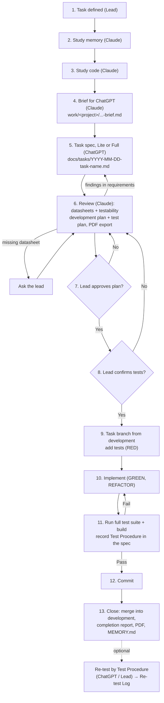
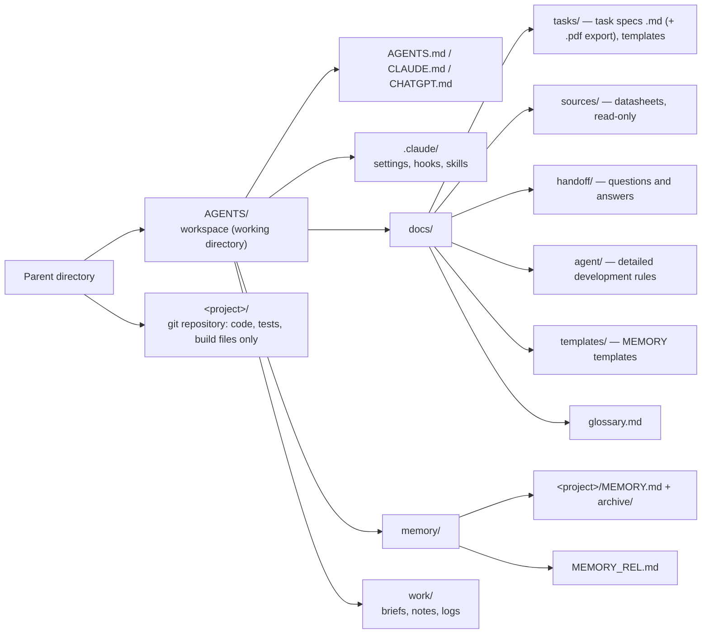

# AGENTS.md — Shared Rules for Collaborative Development

This document is mandatory for all participants: the human lead, ChatGPT and Claude.
If rules conflict, the priority is:
**direct instruction from the lead > AGENTS.md > CLAUDE.md / CHATGPT.md > docs/agent/***.

## 0. MAIN RULES

### 0.1 Language and Format

These rules override everything else in this workspace.

| What | Requirement |
|---|---|
| All documents created as a result of work (task specs, questions, answers, translations, memory, notes, these instruction files) | **Strictly English**, **Markdown (`.md`) format** |
| PDF | Only an **export copy** of a task spec, generated locally from the `.md`. Never edited, never used as input, never analyzed |
| Diagrams inside documents | **Mermaid only** (fenced ` ```mermaid ` blocks); no ASCII art, no embedded images of diagrams |
| Code: identifiers, comments, commit messages | English |
| Commit messages | No additional signatures/trailers; format matches the repository's existing commits ([docs/agent/git.md](docs/agent/git.md)) |
| Claude's internal reasoning | English |
| Replies to the lead in chat | **Russian** |

### 0.2 Document Placement — Working Directory vs. Repositories

| What | Where |
|---|---|
| **All working and temporary documents** — task specs, briefs, questions, answers, translations, memory files, notes, drafts, logs | **Working directory (this workspace), outside the project repositories** |
| **Documents inside a project repository** (README, design docs, any `.md`, `.rst`, `.pdf`, `.docx`, …) | **Only on explicit request from the lead** |

- Agents never add, commit or leave working documents inside a repository. Only code, tests and build files
  required by the task go into the repository.
- Code comments with requirement IDs (`/* REQ-UARTDMA-03 */`) and test names are code, not documents — allowed.
- Enforced for Claude Code by a hook: writing a document file inside a repository requires the lead's confirmation
  ([.claude/hooks/guard-repo-docs.py](.claude/hooks/guard-repo-docs.py)).

### 0.3 Local Development and Tools

- **Development is local.** All tools are installed locally. **No internet search** for datasheets, documentation
  or tools. If a datasheet, document or tool is missing — **ask the lead**; the lead finds and adds it.
- Datasheets and other source documents are in `docs/sources/` (local only).
- **Supported OS: macOS and Ubuntu.** Every script, hook, skill and command must work on both:
  - scripts in **Python 3** (stdlib; extra packages documented with `pip` install) or POSIX `sh`;
  - no GNU-only options (`sed -i` without suffix, `readlink -f`, `date -d`, `grep -P`), no Bash 4+ features
    (macOS ships Bash 3.2), no `jq` dependency;
  - binaries are located per OS (e.g. Chrome: `google-chrome` on Ubuntu, `/Applications/Google Chrome.app/...` on macOS);
  - install instructions are given for both (`apt` / `brew`).
- **Skills for repeatable local procedures.** Once the tools and the exact sequence of steps for a local
  procedure are established (build, test run, flashing, static analysis, PDF export, …), Claude creates a
  **skill** in this workspace: `.claude/skills/<name>/SKILL.md` (plus scripts next to it), so the procedure is
  reused instead of rediscovered. A skill records: purpose, prerequisites for macOS and Ubuntu, exact commands,
  expected output, known problems. A procedure specific to one repository is recorded in that project's
  `MEMORY.md` and, if reused, as a skill named `<project>-<procedure>`.

Applies to both Claude and ChatGPT.

## 1. Project

- Type: embedded development, C/C++. Build: CMake. Tests: GoogleTest / GoogleMock.
- Process: **Test-Driven Development (TDD)** — see [docs/agent/testing.md](docs/agent/testing.md).
  Every requirement becomes a test before it becomes code.
- Platform, toolchain, RTOS: see [docs/agent/embedded.md](docs/agent/embedded.md) (TBD).

### Adapting to existing repositories

Projects are developed in **existing repositories**. Everything marked `TBD` or `[ASSUMPTION]` in these
instructions (platform, toolchain, C/C++ standard, code style, naming, directory layout, CMake structure,
test layout, commit format, branch naming, merge method, static analysis) is **derived from the repository being worked on**:

- Before the first task in a repository, analyze it: `CMakeLists.txt` / toolchain files, `.clang-format`,
  `.clang-tidy`, `.editorconfig`, existing source and test code, `git log`, branches, CI configuration, README.
- **Existing repository conventions take precedence** over defaults and `[ASSUMPTION]` items in these documents.
  The Main Rules (section 0) and TDD are not overridden.
- Record the detected conventions in the project's `MEMORY.md` as decisions (`D-NNN`, author: the agent,
  reference: files the convention was derived from).
- If conventions are inconsistent or missing — follow the most recent code, and ask the lead.

## 2. Roles

| Participant | Responsible for | Does not do |
|---|---|---|
| **Lead** (human) | Defines tasks and priorities; passes materials between agents; provides missing datasheets/tools; approves plan; confirms tests; accepts results | — |
| **ChatGPT** | **Writes the task spec** (Lite or Full) from the task statement and Claude's brief; **re-tests** by the "Test Procedure" of a spec when asked; translations on request; answers requirement questions | Does not write code; does not write the developer review, development plan or test plan; does not analyze source documents for the spec |
| **Claude** | Studies memory and code, writes the brief for ChatGPT; **checks the spec against local datasheets and checks requirements for testability**; writes the development and test plans; exports the PDF; writes tests and the "Test Procedure", implements, runs tests, commits, merges into `development` | Does not change requirements written by ChatGPT (raises findings instead); does not add tests before confirmation or implement before plan approval; does not search the internet |

## 3. Development Workflow



| # | Step | Who | Output |
|---|---|---|---|
| 1 | **Task defined** | Lead | Task statement in chat; datasheets in `docs/sources/` if needed |
| 2 | **Study memory** | Claude | `memory/<project>/MEMORY.md`, `memory/MEMORY_REL.md`, earlier task specs |
| 3 | **Study code** | Claude | Relevant code, tests, build files in `../<project>/`; conventions on the first task in a repository |
| 4 | **Brief for ChatGPT** | Claude | `work/<project>/YYYY-MM-DD-<task-name>-brief.md`: task, code context, memory context, proposed type (Lite/Full), tag, relevant datasheets |
| 5 | **Task spec** | ChatGPT | `docs/tasks/YYYY-MM-DD-<task-name>.md` from [_TEMPLATE_LITE.md](docs/tasks/_TEMPLATE_LITE.md) or [_TEMPLATE_FULL.md](docs/tasks/_TEMPLATE_FULL.md) |
| 6 | **Review** | Claude | "Developer Review": every requirement/parameter checked against **local** datasheets; every requirement checked for testability; missing materials requested from the lead. Then "Development Plan" and "Test Plan"; PDF export |
| 7 | **Approve plan** | Lead | Recorded in the "Approvals" table of the spec |
| 8 | **Confirm tests** | Lead | Recorded in the "Approvals" table. **Tests are added only after this** |
| 9 | **Add tests** | Claude | Task branch from `development`; tests from the confirmed plan, each seen failing (RED); "Test Procedure" started |
| 10 | **Implement** | Claude | Minimal code to pass, then refactor (TDD) |
| 11 | **Run tests** | Claude | Full test suite and build pass; **"Test Procedure" in the spec completed in the strict format** (environment, tools with versions, prerequisites for macOS/Ubuntu, exact steps, results) and validated |
| 12 | **Commit** | Claude | Commit(s) on the task branch per [docs/agent/git.md](docs/agent/git.md) |
| 13 | **Close** | Claude | Merge the task branch into `development`; "Completion Report"; PDF re-export; `MEMORY.md`; status `Done`. Push — only on request |
| — | **Re-test** (optional) | ChatGPT / Lead | Execute "Test Procedure" exactly as written; add a row to "Re-test Log" ([docs/agent/testing.md](docs/agent/testing.md), "Test Procedure Format") |

### Task spec types

| Type | When | Template |
|---|---|---|
| **Lite** | Bug fixes, small local changes (one module, no interface/architecture change, no hardware timing) | [docs/tasks/_TEMPLATE_LITE.md](docs/tasks/_TEMPLATE_LITE.md) |
| **Full** | Features, interface/architecture changes, hardware-related work, several modules | [docs/tasks/_TEMPLATE_FULL.md](docs/tasks/_TEMPLATE_FULL.md) |

Claude proposes the type in the brief; the lead decides.

### Task spec file

- Location: `docs/tasks/`. Name: **`YYYY-MM-DD-<task-name>.md`** — date + short task name in English, kebab-case.
  Example: `2026-11-02-uart-dma-driver.md`.
- **All task specs are Markdown.** The PDF (`YYYY-MM-DD-<task-name>.pdf`, same folder) is only an export copy,
  generated locally with the `export-pdf` skill after every change of the `.md`.
- Sections have owners (stated in the template). Each participant edits only their own sections; findings about
  someone else's section are raised, not silently fixed.
- Changes after approval: version bump + "Revision History"; changes to requirements, plan or tests need re-approval.

### Approvals

- The lead records decisions in the **"Approvals" table of the task spec** (gate, decision, date, notes).
  If the lead approves in chat, Claude records it in the table with the note "via chat".
- **No tests before "Tests: Confirmed", no implementation before "Plan: Approved".**
- If implementation shows that the plan or tests must change — stop, update the spec, get re-approval.

## 4. Workspace Layout

The workspace (working directory, this `AGENTS/` folder) holds the instructions, skills and all working documents.
Project repositories live **one level above**, next to the workspace — so nothing in the workspace is inside a repository.



- `../<project>/` — the project's git repository, a sibling of the workspace. A project is any directory
  next to `AGENTS/` that is a git repository. If a repository lives elsewhere, its path is recorded in
  "Project Summary" of its `MEMORY.md`.
- Claude Code is started from the workspace (`AGENTS/`) so that these instructions, hooks and skills are loaded;
  repositories are accessed as `../<project>/`.
- `work/<project>/` — temporary documents; may be cleaned up by the lead at any time; not a source of truth.

## 5. General Rules

- **Consistent terminology.** Terms are defined in [docs/glossary.md](docs/glossary.md).
- **Source references.** Every requirement or parameter (register, timing, voltage, etc.)
  includes a reference: local document + section/page/table, or code location.
- **Assumptions are marked explicitly**: `[ASSUMPTION]`. An assumption is not a requirement
  until the lead confirms it.
- **Do not invent.** If data is missing, write `TBD` and ask the lead.
- **Requirement IDs** are `REQ-<TAG>-<NN>`, where `<TAG>` is the short uppercase task tag from the spec
  header (e.g. `REQ-UARTDMA-03`). Tests and code comments reference these IDs.

## 6. Project Memory — MEMORY.md and MEMORY_REL.md

Local project memory is shared by all agents and the lead. It is the single source of truth
for what changed, when, by whom and why. Files are English Markdown and live in the working directory,
**outside the repositories** (section 0.2).

| File | Where | When |
|---|---|---|
| `MEMORY.md` | `memory/<project>/MEMORY.md` — one per project under development | Always — created when the project appears |
| `MEMORY_REL.md` | `memory/MEMORY_REL.md` | Only when projects are related (shared code, protocol, hardware, interface, dependency) |

`<project>` is the repository directory name (`../<project>/`).

Templates: [docs/templates/MEMORY_TEMPLATE.md](docs/templates/MEMORY_TEMPLATE.md),
[docs/templates/MEMORY_REL_TEMPLATE.md](docs/templates/MEMORY_REL_TEMPLATE.md).

### Triggers — files are created and updated automatically

| Trigger | Action |
|---|---|
| **New project appears** — a new git repository next to the workspace, or work starts on a project without `MEMORY.md` | Create `memory/<project>/MEMORY.md` from the template immediately, fill "Project Summary" and "Current State", add `C-001: Project created / memory initialized` |
| **A relation between projects is detected** | Create `memory/MEMORY_REL.md` (if missing), add relation `R-NNN` and an `XC-NNN` entry |
| **Any change or decision** during a task | Append entries as described under "Rules" |
| **Command "update local memory"** (RU: «обнови локальную память», «обновить локальную память») or `/memory-update` | Run the full update procedure below |

Full update procedure (on command):

1. Scan the parent directory for git repositories (projects). For each project without `memory/<project>/MEMORY.md` — create it.
2. For each project, compare the current state with the last memory entry (git log, task specs, `Q-*` answers).
   Append `C-NNN` / `D-NNN` entries for unrecorded changes and decisions, marked `[RECONSTRUCTED]`.
3. Refresh "Current State" in every `MEMORY.md`.
4. Detect relations between projects; create/update `memory/MEMORY_REL.md`.
5. Apply size control (below).
6. Report to the lead (in chat, Russian): files created, entries added, files archived, what could not be determined.

**Automatic check (Claude Code).** A `SessionStart` hook ([.claude/hooks/check-memory.py](.claude/hooks/check-memory.py))
reminds Claude about projects without `MEMORY.md`, a missing `MEMORY_REL.md` (2+ projects) and oversized memory files.

### Size control

Memory files are read at the start of every task, so their size is limited:

- **Limit:** `MEMORY.md` and `MEMORY_REL.md` — **300 lines or 30 KB**, whichever comes first.
- **When exceeded**, the oldest entries are moved **verbatim** to `memory/<project>/archive/MEMORY-YYYY.md`
  (`memory/archive/MEMORY_REL-YYYY.md` for cross-project), by the year of the entry:
  - "Change History": keep the latest 50 entries;
  - "Decisions": keep all decisions with status `Accepted`; move `Superseded` ones;
  - "Current State" and "Project Summary" stay and are kept short.
- The main file gets a line in "Archive": file name + ID range moved. Archiving is the only allowed way to remove
  entries from the main file; archived entries are never edited.
- Archive files are read only when older history is needed.

### What is recorded

- **Change history** — every change: date, agent, what changed, files, commit, task spec / REQ reference.
- **Decisions** — context, decision, rationale, rejected alternatives, who approved.
- **Current state** — short summary of where the project is now, kept up to date.
- In `MEMORY_REL.md` additionally: relations between projects, shared interfaces/contracts, cross-project changes and decisions.

### Rules

- **Read before work.** Before starting any task, an agent reads the project's `MEMORY.md`
  (and `MEMORY_REL.md` if it exists).
- **Update after work.** After every change or decision, the agent that made it adds an entry
  in the same session — before reporting the task as done.
- **Append-only.** Existing entries in "Change History" and "Decisions" are never edited or deleted
  (except archiving, above). Corrections are new entries that reference the old one; a decision is replaced by a
  new decision with status `Supersedes D-NNN`, and the old one gets status `Superseded by D-NNN` (the only allowed edit).
- **Cross-project changes** are recorded in both places: a short entry in each affected `MEMORY.md`
  with a link to the detailed entry in `MEMORY_REL.md`.
- **Facts only.** Record what was done and decided, not plans; unconfirmed items are `[ASSUMPTION]`.
- **Entry IDs:** changes `C-NNN`, decisions `D-NNN` (per project); in `MEMORY_REL.md` — `XC-NNN`, `XD-NNN`.

### Who writes what

| Agent | Records |
|---|---|
| Claude | Code changes and commits, implementation decisions, review findings, build/test results, conventions, skills created |
| ChatGPT | Task specs written/updated, re-test runs and results, requirement clarifications, translations, answers to questions |
| Lead | Approvals, priorities, decisions passed verbally (an agent records them on the lead's behalf, author `Lead`) |

## 7. Skills (Claude Code)

Local skills in `.claude/skills/`, invoked as `/<name>`:

| Skill | Workflow step | Purpose |
|---|---|---|
| `/task-new` | 2–4 | Study memory and code, write the brief for ChatGPT |
| `/task-review` | 6 | Datasheet and testability check, development and test plans, PDF export |
| `/task-implement` | 9–12 | After approvals: task branch, tests (RED), implementation, full test run, Test Procedure (validated), commit |
| `/task-close` | 13 | Merge into `development`, completion report, PDF, memory |
| `/memory-update` | — | Full memory update and size control |
| `/export-pdf` | 6, 13 | Markdown → PDF export copy (offline, macOS + Ubuntu) |

New skills are added per section 0.3.
