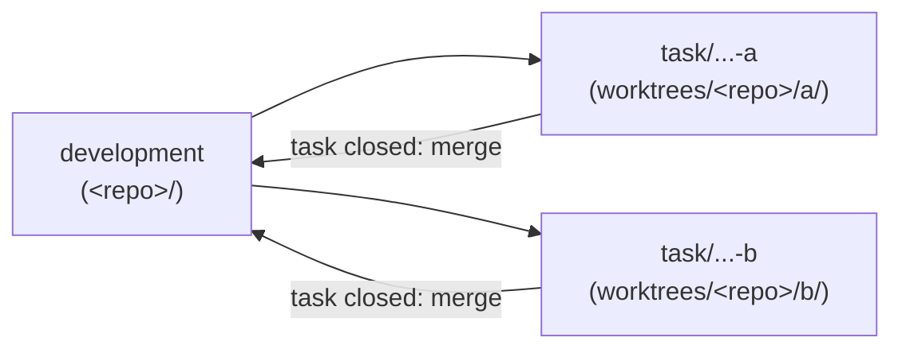

# AGENTS.md — Shared Rules for All AI Agents

This file is the single source of rules for every AI agent working in this repository
(Claude, ChatGPT/Codex, DeepSeek, Copilot, Cursor, Gemini and others).
Agent-specific files (e.g. `CLAUDE.md`) only point here and must not contradict this file.

Priority when rules conflict:
**direct instruction from the user > AGENTS.md > MEMORY.md > agent defaults**.

**Reading order before working with any repository:**

1. `AGENTS.md` (this file) — general rules.
2. [`MEMORY.md`](MEMORY.md) — project-specific details and pitfalls (section 7).

Do not start work in a repository until both files have been read.

## 0. Project Layout

These instructions are a template. The folder that contains this file is placed **inside** the project;
the **project root is one level above** it (`../` relative to this file).

```
<project-root>/
├── <instructions-folder>/   <- this file, MEMORY.md, CLAUDE.md
├── <repo-1>/                <- source code, separate git repository
├── <repo-2>/                <- source code, separate git repository
├── DataSheets/              <- datasheets and other source materials
├── docs/                    <- generated documents
├── tasks/                   <- technical specifications (task specs)
├── tmp/                     <- scripts and intermediate files
├── tools/                   <- Dockerfiles and local build/test tools
└── worktrees/               <- git worktrees of active tasks
```

- Agents are started from the instructions folder; all project work happens in `../`.
- All paths in these instructions and in the agent's reports are relative to the **project root**,
  unless stated otherwise.

| Folder | Purpose | Rules |
|---|---|---|
| `<repo>/` | Source code of the project, one folder per git repository | Only code, tests and build files required by the task. Git rules: section 4 |
| `DataSheets/` | Datasheets, reference manuals, standards | Read only. If a needed document is missing, ask the user |
| `docs/` | Generated documents in any format (`.md`, `.pdf`, `.docx`, `.xlsx`, ...) | Created on the user's request |
| `tasks/` | Technical specifications, one file per task | File name: `YYYY-MM-DD-<task-name>.md` (date the task was created, `<task-name>` in English kebab-case) |
| `tmp/` | Helper scripts and intermediate files | Never cleaned automatically: do not delete files here unless the user asks |
| `tools/` | Build and test tools, Dockerfiles and their notes | See section 6 |
| `worktrees/` | Git worktrees of active tasks: `worktrees/<repo>/<task-name>/` | One worktree per task, see section 4.1 |

- **Temporary and helper files go only to `tmp/`**: scripts, logs, dumps, intermediate data,
  drafts. Do not use the system temp directory or the agent's own scratch area instead.
- **Temporary files must never get into a repository**: do not create them inside `<repo>/`,
  do not stage or commit them. Check `git status` before every commit.
- Documents (`docs/`, `tasks/`) are not placed inside `<repo>/` unless the user asks.
- If a folder is not listed above, ask the user before creating or changing files in it.
- Git commands (section 4) run inside `<repo>/` or the task worktree, not in the project root
  or the instructions folder.

## 1. Language

| What | Language |
|---|---|
| Code: identifiers, string literals, log messages, error messages | English |
| Code comments and docstrings | English |
| Commit messages, branch names, tags | English |
| Documentation and any file added to the repository | English |
| Replies to the user in chat | The user's language |

- **Russian (and any Cyrillic text) is forbidden in the codebase.** It must never get into a file
  that is committed: source code, comments, tests, configs, scripts, docs, commit messages.
- If the user gives a task, a comment text or a name in Russian, translate it into English
  before putting it into the code.
- If existing code already contains Cyrillic text, do not add more; report it to the user
  instead of silently rewriting unrelated code.
- Before every commit, check the staged changes for Cyrillic characters:

  ```sh
  git diff --cached | grep -nP '[\x{0400}-\x{04FF}]'
  ```

  The command must print nothing. If it prints anything, fix it before committing.

## 2. File Format

- All instruction and documentation files are **Markdown (`.md`)**.
- Diagrams inside documents: Mermaid (fenced ` ```mermaid ` blocks).
- Do not create documentation files unless the user asks for them.
- Where files go: generated documents — `docs/`, task specs — `tasks/`,
  temporary files — `tmp/` (section 0).

## 3. Code

- Follow the existing style of the repository (formatting, naming, layout, patterns).
  Check config files first: `.editorconfig`, `.clang-format`, `.clang-tidy`, linters, CI configuration.
- Keep changes focused on the task; do not refactor or reformat unrelated code.
- Comments explain *why*, not *what*. No commented-out code, no leftover debug output.
- Do not add new dependencies without the user's approval.
- Build and run the existing tests before reporting a task as done. Report failures honestly,
  with the actual output.

## 4. Git

### 4.1 Branches

- The main branch of every repository is **`development`**.
- **Every task gets its own branch, created from `development`.** Never commit task work
  directly to `development`.
- Branch name: follow the repository's existing convention (check `git branch -a`).
  If there is none, use `task/YYYY-MM-DD-<task-name>` — the same base name as the task spec
  in `tasks/`.
- If `development` does not exist locally or on the server, stop and ask the user.

#### Parallel tasks

Several tasks can be in progress at the same time, in the same repository. To keep them
from interfering, **each task works in its own git worktree**:

- `<repo>/` (the main working copy) always stays on `development`. Do not switch it to a task
  branch and do not edit code there. It is used for the sync check and for the merge at task close.
- Each task has its own worktree: `worktrees/<repo>/<task-name>/`, checked out on the task branch.
  All code changes, builds and tests of the task happen only there.
- Never touch another task's worktree or branch.
- List active tasks: `git worktree list` (run in `<repo>/`).



#### Sync check (mandatory before creating a branch and before merging)

Run in `<repo>/`:

```sh
git fetch origin
git status --porcelain
git rev-list --left-right --count development...origin/development
```

- `git status --porcelain` prints nothing — the working copy is clean.
- `rev-list` prints `0	0` — local `development` is in sync with `origin/development`.
  The first number is commits only in local `development` (not pushed),
  the second is commits only on the server (not pulled).

**If the code is not in sync** (uncommitted changes, local commits not pushed, server commits
not pulled, or branches diverged): **stop and notify the user** with the output of the commands
above. Do not `pull`, `merge`, `rebase`, `reset` or `stash` to fix it yourself — the user decides
how to sync.

#### Starting a task

1. Sync check (above) passes.
2. Create the task branch and its worktree from `development` (run in `<repo>/`):

   ```sh
   git worktree add -b task/YYYY-MM-DD-<task-name> ../worktrees/<repo>/<task-name> development
   ```

3. Tell the user the branch name and the worktree path.

#### Closing a task: merge into `development`

When the user closes a task, its changes **must be merged into `development`**:

1. In the task worktree: everything is committed (`git status --porcelain` prints nothing),
   build and tests pass.
2. In `<repo>/`: sync check passes.
3. Merge (run in `<repo>/`), using the repository's merge convention; by default:

   ```sh
   git merge --no-ff task/YYYY-MM-DD-<task-name>
   ```

   The merge commit message follows section 4.2.
4. Build and run tests again on `development`.
5. **Merge conflicts or failing build/tests after the merge — stop and notify the user.**
   Do not resolve conflicts by deleting code or tests, and do not touch the changes of other tasks.
6. Report to the user: merged branch, merge commit, test results. The local `development` is now
   ahead of the server — push only when the user asks.
7. The task branch and worktree are kept. Remove them only when the user asks:
   `git worktree remove ../worktrees/<repo>/<task-name>`, `git branch -d task/...`.

After a merge, other active task branches do not get the new changes automatically. Do not
merge or rebase them onto `development` unless the user asks; if a task depends on merged
changes, tell the user.

### 4.2 Commit message format

The commit message format **must match the existing history of the repository**.
Before the first commit in a session, inspect the log:

```sh
git log --format='%s%n%b%n---' -n 30
```

Detect and follow:

- subject prefix convention (none, `feat:`, `fix(scope):`, `[MODULE]`, `PROJ-123:`, ...);
- capitalization, mood (imperative / past tense), length, trailing period;
- whether a body is used, and how it is wrapped and formatted;
- how tickets/issues are referenced;
- trailers the repository itself uses (e.g. `Signed-off-by`), if any.

If the history is inconsistent, follow the most recent commits.

If the repository has no history yet, use a short subject in English, capitalized,
imperative mood, no prefix, no trailing period, no body (e.g. `Add UART driver`),
and tell the user which format was chosen.

### 4.3 Mandatory rules

- English only (see section 1).
- **No extra signatures or trailers** that the history does not use: no `Co-Authored-By`,
  no "Generated with ...", no agent names, no emoji, no links to sessions.
- One logical change per commit.
- Allowed without asking: `git fetch`; creating a task branch and worktree after a successful
  sync check (4.1); commits on the task branch within the task.
- Merge into `development` — when the user closes the task (4.1).
- Push, pull, rebase, rewrite history, delete branches or worktrees **only when the user asks**.
- Never commit secrets, credentials, build artifacts, local editor/agent files,
  or anything from `tmp/`, `docs/`, `tasks/`, `DataSheets/`.

## 5. Safety

- Before deleting or overwriting a file, look at it first.
- Do not run destructive commands (`git reset --hard`, `git push --force`, `rm -rf`, `git clean`)
  without explicit permission.
- If a requirement is unclear or a decision belongs to the user, ask instead of guessing.

## 6. Build and Test Tools

All tools needed to build and test the code (compilers, toolchains, SDKs, test frameworks,
linters, flashing and debug utilities) are provided in this order of priority:

1. **System tools (preferred)** — if the tool is already installed on the host, use it.
   - Check it is available and its version suits the repository (toolchain files, CI config,
     README): e.g. `command -v <tool>`, `<tool> --version`.
   - Use it as is: do not upgrade, downgrade or reconfigure system tools.
   - If the tool is missing or its version does not suit the repository, go to step 2.
2. **Docker** — if no suitable system tool is available.
   - If the repository already has a Docker setup (`Dockerfile`, `docker-compose.yml`,
     `.devcontainer/`, CI image), use it.
   - Otherwise create one outside the repository: `tools/docker/<repo>/Dockerfile`
     (put it into `<repo>/` only if the user asks).
   - Mount the task worktree into the container and run the build and tests inside it,
     e.g. (run from the project root):

     ```sh
     docker build -t <repo>-build tools/docker/<repo>
     docker run --rm -v "$PWD/worktrees/<repo>/<task-name>:/work" -w /work <repo>-build <build-or-test-command>
     ```

   - Pin versions: base image tag and package versions, no `latest`.
3. **`tools/` folder** — only if Docker is not possible either (no Docker on the host,
   the tool needs direct hardware/USB access, no Linux image of the tool, etc.).
   - Install into `tools/<tool-name>-<version>/` (portable archive, `--prefix`, Python venv
     `tools/venv/`, ...). Call tools by their path in `tools/`; do not change the global `PATH`
     or shell profile.

Rules for all options:

- Tell the user which option was used for each tool (system, Docker or `tools/`) and, if it is
  not the system tool, why.
- **Do not install tools system-wide**: no `sudo apt install`, `brew install`, global
  `pip install` / `npm install -g`. If a system-level component is unavoidable (e.g. Docker itself,
  USB drivers, udev rules), ask the user.
- Every tool is recorded in `tools/README.md`: name, version, source (URL or package), how it was
  installed (Docker image, system tool with its path, or path in `tools/`), and the commands
  to build and run tests.
  Check this file first: reuse what is already there instead of installing again.
- Downloads and installations of new tools — tell the user what is being installed and why.
- Do not put tools, archives, images or their caches inside `<repo>/`.

## 7. MEMORY.md — Project Knowledge

[`MEMORY.md`](MEMORY.md) (next to this file) holds the specifics of working with the project
repositories: non-obvious build steps, hardware quirks, known pitfalls, decisions and their reasons.

- **Read it** after `AGENTS.md`, before any work in a repository.
- **Write to it only when the user asks** (e.g. "add this to MEMORY", "remember this").
  Never add, change or delete entries on your own initiative. If something looks worth recording,
  suggest it to the user and wait for an answer.
- The agent's own built-in memory (if any) does not replace `MEMORY.md`: project knowledge
  that should be shared between agents goes only to `MEMORY.md`, and only on request.
- Format: English, Markdown, follow the structure described at the top of `MEMORY.md`.
- If an entry contradicts the code or `AGENTS.md`, do not act on it silently — tell the user.
