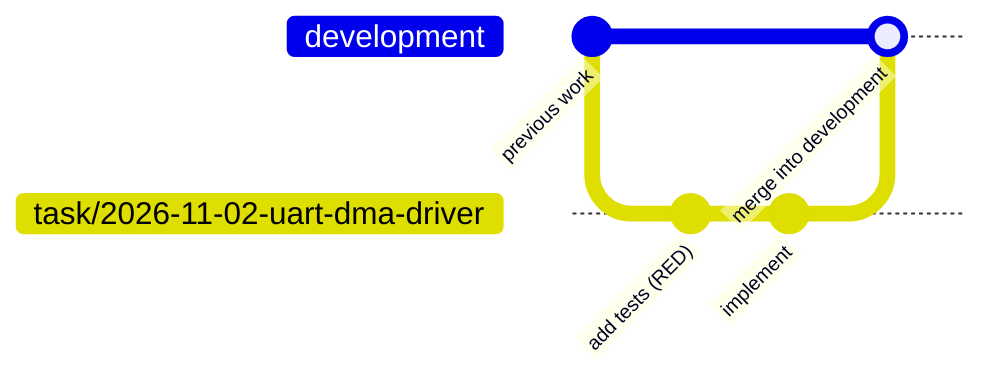
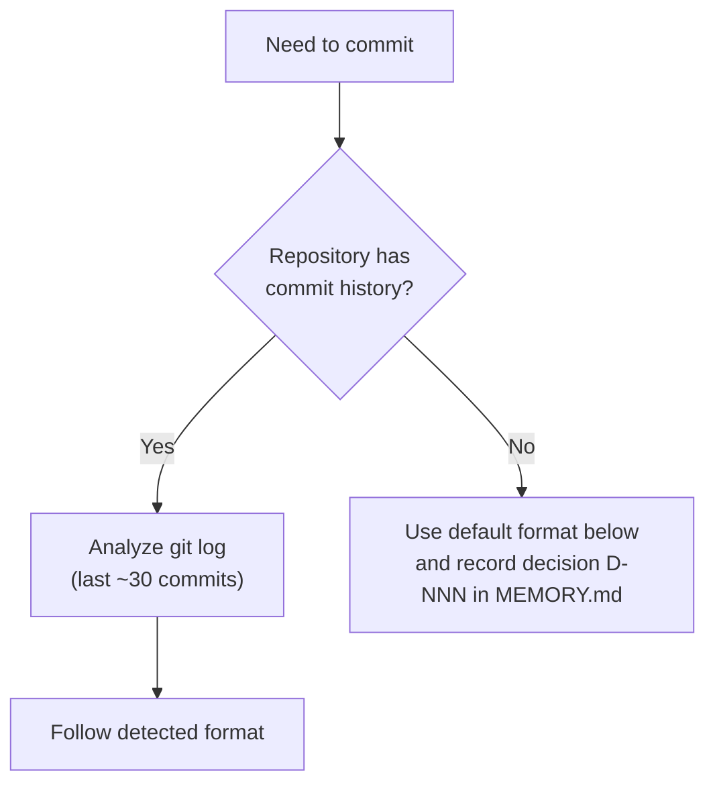

# Git

> **Commit** — workflow step 12 (AGENTS.md, section 3), after the full test suite passes, within an approved task.
> **Merge into `development`** — step 13, when the task is closed. **Push** — only on explicit request from the lead.
> `TBD` / `[ASSUMPTION]` items are derived from the existing repository being worked on and recorded in its `MEMORY.md` (AGENTS.md, section 1, "Adapting to existing repositories").

## Branches



- **One branch per task**, created from the latest local `development` at step 9 (before the first test is added).
- Name: `task/YYYY-MM-DD-<task-name>` — same base name as the task spec. If the repository has its own branch
  naming convention, it takes precedence (recorded in `MEMORY.md`).
- The branch name is written into the task spec header ("Branch").
- If `development` does not exist in the repository — ask the lead before creating anything.

## Merge into `development` (task close)

1. Full test suite and build pass on the task branch.
2. Update local `development` only if the lead allows fetching; otherwise merge into the local branch as is.
3. Merge the task branch into `development` using the repository's convention; default [ASSUMPTION]: `git merge --no-ff`.
   The merge commit message follows the commit format rules below (no additional signatures).
4. Run the full test suite and build again on `development`.
5. **Merge conflicts or failing tests after the merge → stop and ask the lead**; never resolve by deleting tests or code
   of others.
6. The task branch is kept; deleting it — only on request.

## Commit Messages — Mandatory Rules

1. **English only.**
2. **No additional signatures or trailers**: no `Co-Authored-By`, no "Generated with ...",
   no `Signed-off-by` (unless the repository already uses it), no agent names, no emoji tags,
   no session links. The message describes the change and nothing else.
   Enforced for Claude Code via `attribution` in `.claude/settings.json`.
3. **Match the repository's existing commit format.**

## How to Determine the Format

Before the first commit in a repository, inspect its history:

```sh
git log --format='%s%n%b%n---' -n 30
```

Determine and follow:
- Subject style: prefix convention (`feat:`, `fix(scope):`, `[MODULE]`, `PROJ-123:`, none), capitalization,
  mood (imperative / past tense), max length, trailing period or not.
- Body: present or not, wrapping width, bullet style.
- Issue/ticket references: where and in which form.
- Trailers that the repository itself uses (e.g. `Signed-off-by`, `Refs:`) — keep them if they are part of the format.

If the history is inconsistent, follow the style of the most recent commits.



## Default Format (empty repository only) [ASSUMPTION]

```
<type>(<scope>): <short imperative summary, max 72 chars, no period>

<optional body: what and why, wrapped at 72 chars>
```

`type`: `feat`, `fix`, `refactor`, `docs`, `test`, `build`, `chore`.

## Allowed Without Request

- Creating the task branch (step 9) after the plan is approved and the tests are confirmed.
- Commits on the task branch after the full test suite passes (one or more logical commits).
- Merging the task branch into local `development` at task close.
- Everything else (push, fetch/pull of remotes, branch deletion, history rewrite, tags) — only on request.
