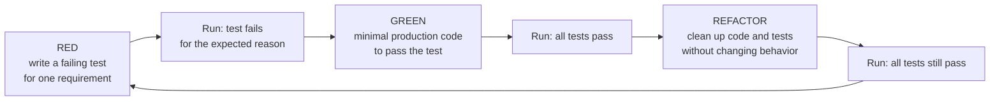
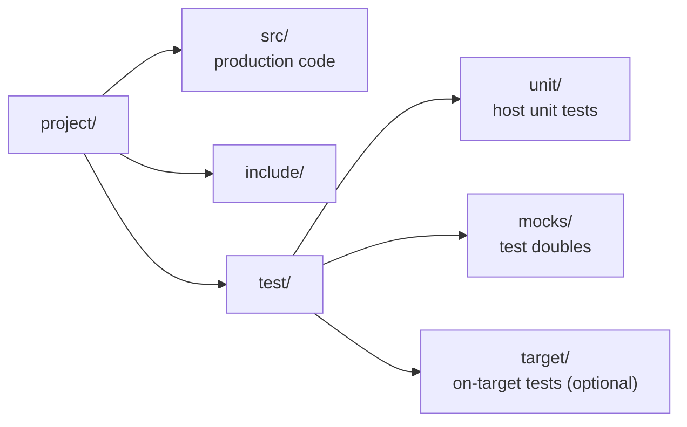

# Development Process: TDD

All development follows **Test-Driven Development (TDD)**. No production code is written
without a failing test that requires it.

## TDD Cycle



1. **RED** — write one small test for the next piece of behavior. Run it and confirm it **fails,
   and fails for the expected reason** (not a compile error in unrelated code, not a typo).
2. **GREEN** — write the minimal production code that makes the test pass. Nothing beyond what the test requires.
3. **REFACTOR** — improve structure, naming, duplication in both code and tests. All tests stay green.
4. Repeat until every requirement of the spec is covered.

## Rules

- **Test first, always.** Production code without a test that drove it is not accepted.
  Exception only with explicit approval from the lead (e.g. startup code, linker scripts, generated code);
  such exceptions are recorded as `D-NNN` in `MEMORY.md`.
- **Requirements → tests.** Every `REQ-*` from the spec has at least one test. Test names or comments
  start with the requirement ID, e.g. `TEST(CrcFrame, REQ_UARTDMA_03_RejectsCorruptedFrame)`.
  The task spec's acceptance criterion is the basis of the test.
- **Tests only after confirmation.** Tests are written from the test plan of the task spec and only after the lead
  confirms them (AGENTS.md, section 3, step 7). Additional tests discovered during work → update the test plan, re-confirm.
- **One behavior per test.** Small, independent, deterministic tests; no order dependencies.
- **Never weaken a test to make it pass.** Changing a test's expectation requires a reason
  (task spec change re-approved by the lead, `Q-NNN` answer) recorded in `MEMORY.md`.
- **Bug fixes start with a test** that reproduces the bug (RED), then the fix (GREEN).
- **The full test suite passes** before a task is reported as done.

## Embedded Specifics

- **Host-first.** Business logic, protocols, state machines, parsers, algorithms are tested on the host (PC),
  without hardware.
- **Hardware isolation.** Hardware access goes through a thin abstraction layer (HAL / driver interface),
  so that logic can be tested with test doubles (mocks, fakes, stubs) of that layer.
- **Register-level drivers** are tested against a fake register map or mocked HAL calls where practical.
- **On-target tests** (hardware-in-the-loop) only for what cannot be verified on the host
  (timings, real peripherals) — and only with the lead's confirmation (see [safety.md](safety.md)).
- Time, interrupts and concurrency are made injectable/controllable in tests (fake clock, manual ISR trigger).

## Test Structure (per project) [ASSUMPTION]



## Tools

| Item | Value |
|---|---|
| Build system | **CMake** |
| Unit test framework | **GoogleTest** |
| Mocking | **GoogleMock** (part of GoogleTest) |
| Test runner | CTest (`gtest_discover_tests`) |
| Coverage | **Requirements coverage** — see below |
| Static analysis | TBD |

### Test naming (GoogleTest)

```cpp
// Suite = module under test; test name starts with the requirement ID.
TEST(CrcFrame, REQ_UARTDMA_03_RejectsCorruptedFrame) { ... }
```

### Testing C code with GoogleTest

C headers are included with `extern "C" { ... }`. Hardware/HAL functions are replaced at link time
by fakes in `test/mocks/` (or wrapped behind a C++ interface and mocked with GoogleMock).

### Commands (host build) [ASSUMPTION — adjusted per project]

```sh
cmake -S . -B build-host -DBUILD_TESTING=ON
cmake --build build-host
ctest --test-dir build-host --output-on-failure
```

The host test build is separate from the target (cross-compiled) build; tests are never linked into firmware.

## Coverage — Requirements Coverage

Coverage is measured **against the spec requirements**, built up during development:

- Every `REQ-*` of the task spec must be covered by at least one test — **100% requirements coverage** is mandatory.
- A requirement counts as covered when its test was seen failing (RED) and then passing (GREEN).
- Coverage is tracked in the report table `REQ → test(s) → result`; an uncovered requirement blocks "Done".
- Code that no requirement needs should not exist (TDD: no code without a driving test).
- Line/branch coverage (gcov/lcov) is not a gate; it may be used as a diagnostic to find untested code.

## Verification Levels (state explicitly in the report)

- **Built** — compiles and links (host and target).
- **Tested on host** — unit tests pass.
- **Verified on hardware** — only if the lead confirmed running on the board.
- **Not verified** — with the reason.

## Done Criteria for a Task

1. Every `REQ-*` in scope has a test that was seen failing (RED) and now passes (GREEN).
2. The full test suite passes; the project builds without new warnings.
3. The "Completion Report" of the task spec lists `REQ → test name → result`.
4. `MEMORY.md` is updated.

## Test Procedure Format (strict)

Every task spec has a **"Test Procedure"** section and a **"Re-test Log"** section (templates in `docs/tasks/`).
Claude fills "Test Procedure" **during testing** (workflow steps 9–11) and updates it after every change of the
commands, tools or results. Its purpose: anyone — Claude, ChatGPT, the lead — can repeat the tests from this section
alone, without any other context.

The format is fixed; it is checked by
`python3 .claude/skills/task-implement/check_test_procedure.py docs/tasks/<file>.md` (must print `OK` before commit).

| Subsection | Strict content |
|---|---|
| Environment | Table with exactly these rows: OS, Repository, Branch, Commit, Compiler, CMake, GoogleTest, Other tools. Real values with versions (from `--version` output), no placeholders |
| Prerequisites | Table `# \| Ubuntu \| macOS`: exact install commands for both OS (`apt` / `brew` / `pip`); `none` if nothing is needed |
| Steps | `#### STEP-NN: <title>`, numbered from `01` without gaps. Each step has exactly: `- Working directory:`, `- Command:` followed by one ` ```sh ` block, `- Expected:`, `- Pass criterion:`. If the command differs per OS — add `- Command (macOS):` with its own block |
| Test Results | Table `Test \| REQ \| Result \| Date \| Run by`, one row per test; test name `Suite.REQ_<TAG>_<NN>_<Behavior>`; result `pass` / `fail` / `skip`; date `YYYY-MM-DD` |
| Summary | One row: `Total \| Passed \| Failed \| Skipped \| Full suite \| Date \| Run by`; Total = Passed + Failed + Skipped = number of rows in Test Results |

Rules for commands:
- Copy-paste ready: no placeholders, no "etc.", no interactive steps, one command block per step.
- Paths relative to the stated working directory; no user-specific absolute paths.
- Only tools listed in Environment / Prerequisites; POSIX `sh` syntax that works on macOS and Ubuntu.
- Expected output is quoted exactly as the tool prints it (e.g. the `ctest` summary line).
- Results are copied from the real run, never written in advance.

### Re-test Log

- Every repeated run (by ChatGPT, the lead or Claude) adds one row:
  `R-NN | YYYY-MM-DD | <who> | <OS + version> | <commit> | STEP-01..STEP-NN | pass/fail | none or details`.
- Steps are executed **exactly as written**. Any deviation (different command, tool version, skipped step) is
  recorded in the last column; a failure is described with the step ID and the actual output.
- A failed re-test is reported to the lead; Claude analyses it and, if the procedure was wrong, fixes the
  "Test Procedure" section (version + "Revision History").
