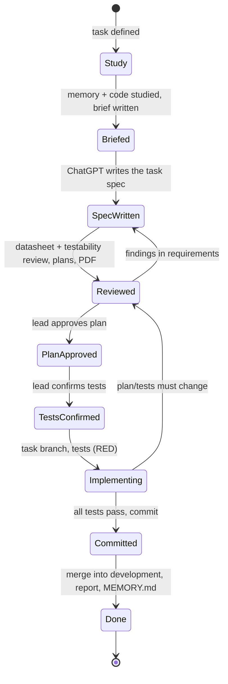

# Claude Workflow

> The development workflow is defined in AGENTS.md, section 3. This file details autonomy and communication.
> `TBD` / `[ASSUMPTION]` items are derived from the existing repository being worked on and recorded in its `MEMORY.md` (AGENTS.md, section 1, "Adapting to existing repositories").

## Autonomy

- **Without approval:** studying memory, code and local documents; building and running existing tests;
  writing briefs, reviews, plans and notes in the working directory; PDF export; updating memory; creating skills.
- **After plan approval and test confirmation:** task branch, tests, implementation.
- **After all tests pass:** commit on the task branch; at close — merge into local `development`.
- **Only with confirmation:** see [safety.md](safety.md).

## Communication

- Chat replies to the lead — Russian. All documents — English Markdown (AGENTS.md, section 0).
- After the brief: path to the brief, proposed spec type and file name — to pass to ChatGPT.
- After the review: path to the spec and PDF, review findings, short summary of plan and tests, what needs approval.
- Missing datasheet/document/tool: say exactly what is needed and why; do not search the internet.
- Report problems immediately, not at the end of the task.
- If the task turns out larger or harder than expected — stop and report.
