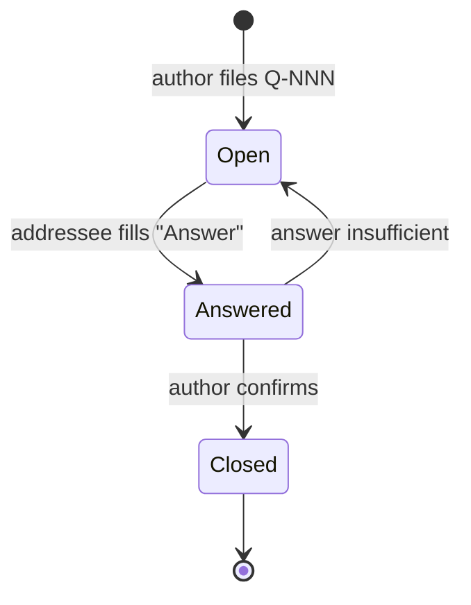

# docs/handoff — Exchange Between Agents

Questions and answers live here (task specs, reviews and completion reports are in `docs/tasks/`). The agents do not talk to each other directly — the lead
passes materials between them, so every file must be self-contained (understandable without chat context).

All files: English, Markdown, diagrams in Mermaid.



## Questions: `Q-NNN-short-name.md`

```markdown
# Q-NNN: <short summary>

- From: Claude | ChatGPT
- To: ChatGPT | Lead
- Task spec / requirement: docs/tasks/YYYY-MM-DD-<task-name>.md, REQ-<TAG>-NN
- Blocking: yes / no
- Status: Open / Answered / Closed

## Question
What is unclear and why (quote from the task spec / source / code with reference).

## Options (if any)
1. ... — consequences
2. ... — consequences
Author's recommendation: ...

## Answer
(filled by the addressee: answer + source reference; if the task spec changes — its owner updates it and the lead re-approves)
```
