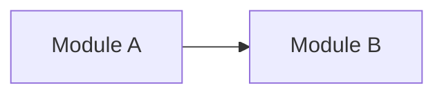

# <Task Title>

<!-- Full task spec: features, architecture changes, hardware-related work.
     File: docs/tasks/YYYY-MM-DD-<task-name>.md ; PDF export copy next to it: YYYY-MM-DD-<task-name>.pdf
     Section owners: ChatGPT — 1–7; Claude — 8–10, 12, 14; Lead — 11; anyone re-testing — 13. -->

| Field | Value |
|---|---|
| Date | YYYY-MM-DD |
| Type | Full |
| Tag | `<TAG>` — short uppercase tag used in requirement IDs (e.g. `UARTDMA`) |
| Project | `<project>` (`../<project>/`) |
| Branch | `task/YYYY-MM-DD-<task-name>` (or per repository convention) |
| Spec author | ChatGPT |
| Version | 0.1 |
| Status | Draft / In review / Plan approved / Tests approved / In progress / Done |
| Brief | `work/<project>/YYYY-MM-DD-<task-name>-brief.md` |
| Datasheets | `docs/sources/...` |

## 1. Task

The task as stated by the lead and its goal.

## 2. Context

Relevant state of the code and memory (from Claude's brief): modules involved, earlier changes/decisions (`C-NNN`, `D-NNN`).



## 3. Scope

- **In scope:** ...
- **Out of scope:** ...

## 4. Functional Requirements

| ID | Requirement | Source | Acceptance Criterion |
|---|---|---|---|
| REQ-<TAG>-01 | ... | lead / datasheet, section, page | concrete, testable: input → expected result |

## 5. Non-Functional Requirements and Constraints

Timing, memory, power, compatibility — with units, tolerances and sources.

| ID | Requirement | Source | Acceptance Criterion |
|---|---|---|---|
| REQ-<TAG>-50 | ... | ... | ... |

## 6. Interfaces and Error Handling

Protocols, data formats, registers, external APIs; failure cases and required reactions.
Sequences — Mermaid `sequenceDiagram`, state machines — `stateDiagram-v2`.

## 7. Open Questions

| # | Question | To | Blocking? |
|---|---|---|---|
| 1 | ... | Lead | yes/no |

## 8. Developer Review (Claude)

### 8.1 Datasheet check

| REQ / parameter | Datasheet reference (`docs/sources/...`, section, page) | Result |
|---|---|---|
| REQ-<TAG>-01 | ... | confirmed / mismatch: ... / no data — requested from lead |

### 8.2 Testability check

| REQ | Testable? | Level (host / target) | Note |
|---|---|---|---|
| REQ-<TAG>-01 | yes / no — why | host | ... |

### 8.3 Missing materials requested from the lead

- ...

## 9. Development Plan (Claude)

1. ... — files/modules, what changes, why.

Risks: ...

## 10. Test Plan (Claude)

Tests are added **only after the lead confirms them** (section 11).

| Test (GoogleTest) | Covers | Checks | Level |
|---|---|---|---|
| `Suite.REQ_<TAG>_01_<Behavior>` | REQ-<TAG>-01 | input → expected result | host |

Existing tests affected: ...

## 11. Approvals (Lead)

| Gate | Decision | Date | Notes |
|---|---|---|---|
| Development plan (section 9) | Approved / Rejected | YYYY-MM-DD | |
| Tests (section 10) | Confirmed / Rejected | YYYY-MM-DD | |

## 12. Test Procedure (Claude)

_Filled and kept up to date during testing (steps 9–11). Strict format — checked by
`python3 .claude/skills/task-implement/check_test_procedure.py <spec.md>`. Anyone (Claude, ChatGPT, the lead) must be able
to repeat the tests from this section alone. Format rules: docs/agent/testing.md, "Test Procedure format"._

### 12.1 Environment

| Item | Value |
|---|---|
| OS | `<e.g. Ubuntu 24.04>` |
| Repository | `../<project>` |
| Branch | `task/YYYY-MM-DD-<task-name>` |
| Commit | `<hash>` |
| Compiler | `<name version>` |
| CMake | `<version>` |
| GoogleTest | `<version or source>` |
| Other tools | `<name version>` / `none` |

### 12.2 Prerequisites

| # | Ubuntu | macOS |
|---|---|---|
| 1 | `<install command>` | `<install command>` |

### 12.3 Steps

#### STEP-01: Configure

- Working directory: `../<project>`
- Command:

```sh
cmake -S . -B build-host -DBUILD_TESTING=ON
```

- Expected: `<exact expected output fragment or "exit code 0">`
- Pass criterion: `<exit code 0 and ...>`

#### STEP-02: Build

- Working directory: `../<project>`
- Command:

```sh
cmake --build build-host
```

- Expected: `exit code 0, no new warnings`
- Pass criterion: `exit code 0`

#### STEP-03: Run tests

- Working directory: `../<project>`
- Command:

```sh
ctest --test-dir build-host --output-on-failure
```

- Expected: `100% tests passed`
- Pass criterion: `exit code 0 and all tests from 12.4 reported as Passed`

### 12.4 Test Results

| Test | REQ | Result | Date | Run by |
|---|---|---|---|---|
| `Suite.REQ_<TAG>_01_<Behavior>` | REQ-<TAG>-01 | pass | YYYY-MM-DD | Claude |

### 12.5 Summary

| Total | Passed | Failed | Skipped | Full suite | Date | Run by |
|---|---|---|---|---|---|---|
| 0 | 0 | 0 | 0 | pass | YYYY-MM-DD | Claude |

## 13. Re-test Log

_Every repeated run of section 12 (by ChatGPT, the lead or Claude) adds one row. Steps are executed exactly as written;
any deviation is recorded. Row format: `R-NN | YYYY-MM-DD | <who> | <OS + version> | <commit> | STEP-01..STEP-NN | pass/fail | none or details`.
The `—` row means "no re-test yet" and is replaced by the first run._

| Run | Date | Run by | OS | Commit | Steps | Result | Deviations / failures |
|---|---|---|---|---|---|---|---|
| — | — | — | — | — | — | — | — |

## 14. Completion Report (Claude)

_Filled when the task is closed._

- Branch: `task/...` → merged into `development` at `<merge commit>`
- Commits: `<hash>` — `<subject>`
- Requirements coverage:

| REQ | Test(s) | Result | Verification level |
|---|---|---|---|
| REQ-<TAG>-01 | ... | pass | tested on host |

- Deviations from plan: ...
- Not done / follow-ups: ...
- MEMORY entries added: C-NNN, D-NNN

## 15. Revision History

| Version | Date | Author | Changes |
|---|---|---|---|
| 0.1 | YYYY-MM-DD | ChatGPT | Initial version |
