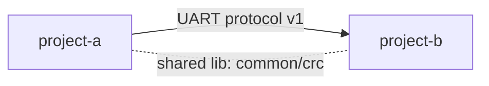

# MEMORY_REL — Related Projects

Cross-project memory shared by all agents. Rules: [AGENTS.md, section 6](../AGENTS.md#6-project-memory--memorymd-and-memory_relmd).
Append-only: never edit or delete existing entries in "Cross-Project Change History" and "Cross-Project Decisions" (except archiving).
Size limit: 300 lines / 30 KB — then archive to `memory/archive/MEMORY_REL-YYYY.md` (AGENTS.md, section 6).

## Projects

| Project | Path | Role in the system | MEMORY.md |
|---|---|---|---|
| <project-a> | `../project-a` | <e.g. sensor node firmware> | `memory/project-a/MEMORY.md` |
| <project-b> | `../project-b` | <e.g. gateway firmware> | `memory/project-b/MEMORY.md` |

## Relations

| ID | Projects | Type | Contract / interface | Source of truth |
|---|---|---|---|---|
| R-001 | project-a → project-b | protocol / shared code / hardware / dependency | <name, version> | <file or spec> |

## Cross-Project Change History

| ID | Date | Author | Change | Affected projects | Local entries | Ref |
|---|---|---|---|---|---|---|
| XC-001 | YYYY-MM-DD | Claude | ... | project-a, project-b | project-a C-NNN, project-b C-NNN | task spec |

## Cross-Project Decisions

### XD-001: <Decision title>

- Date: YYYY-MM-DD
- Author: Claude | ChatGPT | Lead
- Approved by: Lead | not required
- Status: Accepted | Superseded by XD-NNN
- Affected projects: ...
- Ref: task spec / R-NNN / Q-NNN
- **Context:** ...
- **Decision:** ...
- **Rationale:** ...
- **Rejected alternatives:** ...
- **Impact per project:** project-a — ...; project-b — ...

## Archive

| File | Moved entries |
|---|---|
| — | — |
